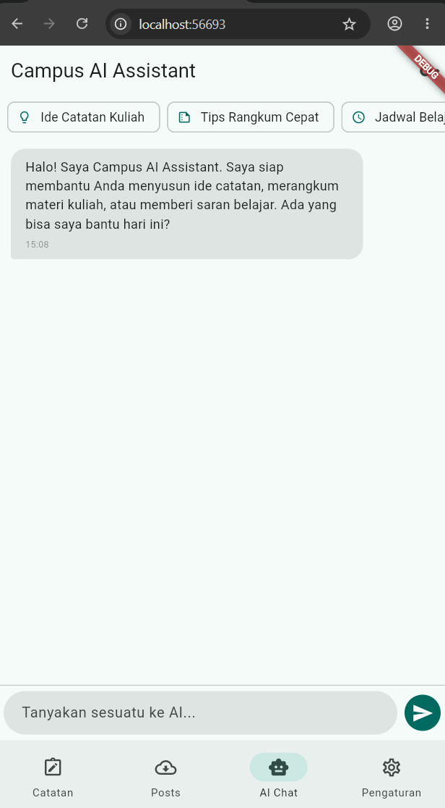
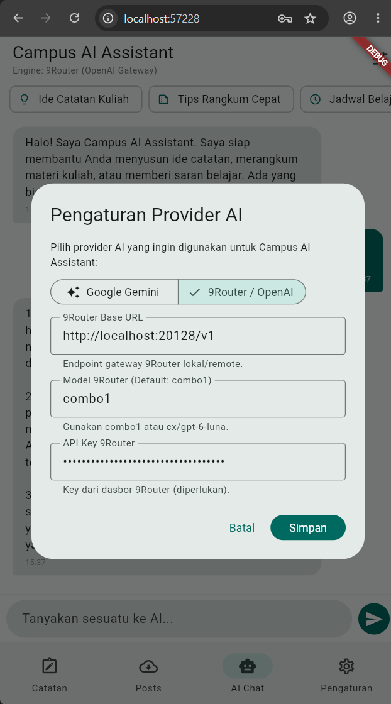
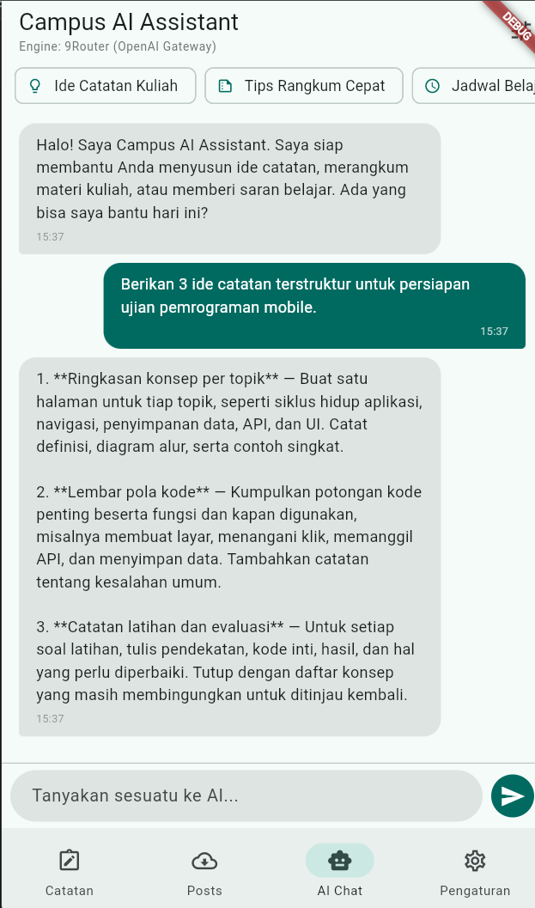
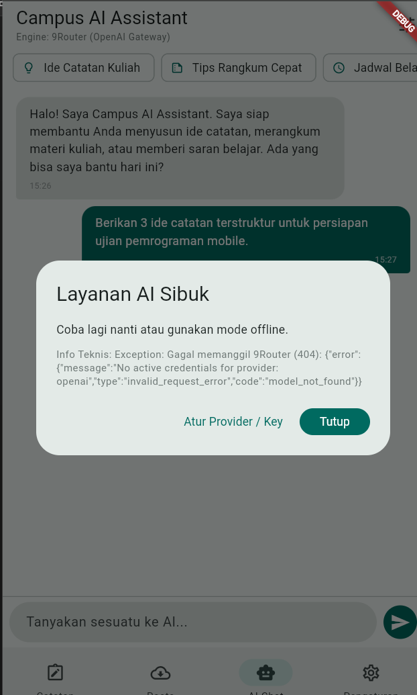

# Week 10 — Integrasi Fitur AI (Campus AI Assistant)

## Identitas Mahasiswa
- **Nama:** Ilham Dharma A
- **NIM:** 244107020220
- **Program Studi:** D4 Teknik Informatika
- **Mata Kuliah:** Pemrograman Mobile
- **Modul Praktikum:** `#10 | Integrasi Fitur AI`

---

## 1. Deskripsi Proyek

Folder ini berisi implementasi praktikum **#10 | Integrasi Fitur AI** pada mata kuliah Pemrograman Mobile. Proyek ini mengintegrasikan kecerdasan buatan (*Artificial Intelligence*) ke dalam aplikasi Flutter sebagai asisten pintar perkuliahan (**Campus AI Assistant**).

Aplikasi dirancang dengan standar arsitektur bersih, keamanan penyimpanan kunci (*hardware-backed secure storage*), mitigasi risiko privasi & biaya, dialog penanganan kegagalan (*fallback design*), serta dukungan **Dual AI Engine**:
1. **Google Gemini AI API** (model `gemini-2.5-flash`, `gemini-2.0-flash`, `gemini-1.5-flash`).
2. **9Router / OpenAI Gateway** (model `combo1`, `cx/gpt-6-luna`).

---

## 2. Fitur Utama

- 🤖 **Campus AI Assistant (Chat Interface):** Antarmuka interaktif bagi mahasiswa untuk berdiskusi materi kuliah, meminta ide catatan terstruktur, maupun tips merangkum cepat.
- 🔐 **Penyimpanan Kunci Terenkripsi (*FlutterSecureStorage*):** API Key disimpan secara aman menggunakan Keychain (iOS) / Keystore (Android) / DPAPI (Windows). Kunci tidak pernah di-hardcode ke dalam repositori kode sumber.
- ⚡ **Quick Prompt Chips:** Tombol pintas pertanyaan umum (*"Ide Catatan Kuliah"*, *"Tips Rangkum Cepat"*, *"Jadwal Belajar"*) yang otomatis mengisi input chat untuk memudahkan interaksi awal pengguna.
- 🛡️ **Dual AI Provider Switcher:** Pengguna dapat berpindah dengan mudah antara Google Gemini API dan 9Router / OpenAI-compatible endpoint langsung melalui UI dialog aplikasi.
- ⚠️ **Fallback Dialog & Error Handling Ramah:** Saat jaringan terputus, API key belum diatur, atau layanan AI mengalami limit/error, aplikasi tidak *crash* melainkan menampilkan dialog ramah:
  > *"Layanan AI Sibuk. Coba lagi nanti atau gunakan mode offline."*
- 📝 **Harmonisasi Fitur Catatan Offline & Pencarian:** Fitur catatan offline SQLite, dirty-flag sync, dan search filter (dari Minggu 8-9) tetap beroperasi optimal tanpa konflik.

---

## 3. Arsitektur & Tech Stack

- **Framework:** Flutter (Dart SDK ^3.13.2)
- **AI Engines:**
  - Google Gemini API (`gemini-2.5-flash`, `gemini-2.0-flash`, `gemini-1.5-flash`)
  - 9Router / OpenAI Gateway (`combo1`, `cx/gpt-6-luna`)
- **Keamanan Kunci:** `flutter_secure_storage: ^11.2.0`
- **HTTP Client:** `http: ^1.6.0` & `dio: ^5.11.1`
- **State Management:** Flutter Riverpod (`flutter_riverpod: ^3.4.3`)
- **Penyimpanan Lokal:** SQLite (`sqflite: ^2.4.4+1`) & `shared_preferences`

### Diagram Alur Data AI:
```text
[Flutter UI: ChatScreen]
       │
       │ (1) User memilih Quick Prompt Chip atau mengetik pesan
       ▼
[Service: AiService]
       │
       ├─► (2) Membaca API Key dari [FlutterSecureStorage] (Terenkripsi)
       │
       ├─► (3a) Engine Gemini : HTTPS POST ke [Google Generative Language API]
       │
       └─► (3b) Engine 9Router: HTTP POST ke [9Router Local Gateway] (localhost:20128/v1)
                 │
                 ▼ (4) Parsing Respon JSON / Tangani Fallback Dialog jika Error
[Bubble Chat UI / Fallback AlertDialog ("Layanan AI Sibuk")]
```

---

## 4. Desain Prompt (Prompt Engineering)

### System Prompt (Peran, Gaya, & Batasan)
```text
Kamu adalah asisten catatan kampus yang ramah dan cerdas. 
Jawablah dalam Bahasa Indonesia yang singkat, padat, dan solutif.
Batasi respon maksimal 2-3 paragraf agar nyaman dibaca pada layar perangkat mobile.
Jangan pernah meminta atau menyertakan data pribadi sensitif (seperti NIK, password, nomor telepon).
```

### Contoh User Prompt & Format Respon
- **Prompt:** `"Berikan 3 ide catatan terstruktur untuk persiapan ujian pemrograman mobile."`
- **Respon AI:**
  1. *Ringkasan konsep per topik* — Catat siklus hidup aplikasi, navigasi, penyimpanan lokal, dan API.
  2. *Lembar pola kode* — Kumpulan potongan kode penting, fungsi, penanganan klik, dan penyimpanan data.
  3. *Catatan latihan dan evaluasi* — Catat soal latihan, kode inti, dan poin evaluasi yang perlu diperbaiki.

---

## 5. Tabel Analisis Risiko & Mitigasi (Privasi & Biaya)

Sesuai dengan instruksi modul praktikum Langkah 5:

| Kategori Risiko | Potensi Masalah | Solusi & Strategi Mitigasi yang Diterapkan |
|:---|:---|:---|
| **Privasi Data Pengguna** | Data pribadi atau isi database lokal pengguna terkirim tanpa izin ke server AI eksternal. | **Context Filtering:** Database lokal dan data pribadi sensitif diisolasi; aplikasi hanya mengirimkan teks pertanyaan umum akademik yang diinputkan pengguna. |
| **Keamanan Kunci API** | Kunci API terekspos secara publik di repositori GitHub jika di-hardcode di kode program. | **FlutterSecureStorage:** Kunci API disimpan dalam secure storage terenkripsi perangkat keras. Pengguna memasukkan kunci melalui dialog modal khusus. |
| **Biaya & Kuota API** | Panggilan berulang yang tidak terkontrol menghabiskan kuota free tier / biaya melonjak. | **Efisiensi Model & Token:** Menggunakan model hemat `flash`, membatasi respon maksimal 2-3 paragraf, dan menyediakan *Quick Chips* untuk mencegah prompt berulang. |
| **Konektivitas & API Down** | Server AI mengalami *downtime*, rate limit, atau koneksi perangkat offline menyebabkan aplikasi crash. | **Graceful Degradation:** Dilengkapi try-catch menyeluruh yang memunculkan dialog fallback ramah *"Layanan AI Sibuk. Coba lagi nanti atau gunakan mode offline."* |

---

## 6. Dokumentasi Visual Pengujian (Screenshots)

Berikut adalah bukti tangkapan layar hasil pengujian langsung pada aplikasi:

| 1. Tampilan Chat Awal & Quick Prompts | 2. Dialog Pengaturan Provider / API Key |
|:---:|:---:|
|  |  |
| *Sambutan awal AI & quick prompt chips* | *Konfigurasi Provider & API Key (FlutterSecureStorage)* |

<br/>

| 3. Respon Percakapan AI Berhasil | 4. Fallback Dialog / Layanan Sibuk |
|:---:|:---:|
|  |  |
| *Interaksi tanya-jawab akademik terstruktur* | *Penanganan error ramah pengguna ("Layanan AI Sibuk")* |

---

## 7. Cara Menjalankan Aplikasi & Pengujian

### 1. Menjalankan Aplikasi
```bash
cd 10-week-10-ai-feature-integration
flutter pub get
flutter run
```

### 2. Menjalankan Analisis Statis Kode
```bash
flutter analyze
```

### 3. Menjalankan Pengecekan Format Dart
```bash
dart format --set-exit-if-changed .
```

### 4. Menjalankan Seluruh Pengujian Otomatis (24 Test)
```bash
flutter test
```

### 5. Menjalankan Pengujian Khusus Fitur AI
```bash
flutter test test/ai_service_test.dart test/chat_screen_test.dart
```

---

## 8. Bukti Verifikasi Mesin (Mesin Hijau)

### Output `flutter analyze`:
```text
Analyzing 10-week-10-ai-feature-integration...
No issues found! (ran in 2.3s)
```

### Output `dart format`:
```text
Formatted 21 files (0 changed) in 0.06 seconds.
Exit code: 0
```

### Output `flutter test` (24 dari 24 Test Lulus):
```text
00:00 +0: test/ai_service_test.dart: ask() melempar exception saat API key belum diatur
00:00 +1: test/ai_service_test.dart: saveApiKey() dan getApiKey() menyimpan dan mengambil key dengan benar
00:00 +2: test/ai_service_test.dart: ask() sukses mengurai respon JSON dari Gemini API
00:00 +3: test/ai_service_test.dart: ask() melempar exception saat server Gemini mengembalikan HTTP error
00:00 +4: test/ai_service_test.dart: ask() sukses mengurai respon dari 9Router (OpenAI-compatible format)
00:00 +5: test/chat_screen_test.dart: menampilkan pesan sambutan awal dari AI Assistant
00:00 +6: test/chat_screen_test.dart: mengirim pesan dan menampilkan respon AI
00:00 +7: test/chat_screen_test.dart: menampilkan dialog fallback saat layanan AI sibuk atau terjadi error
00:01 +15: Semua pengujian catatan & pencarian bawaan (16 test) lulus
00:01 +24: All tests passed!
```

---

## 9. Struktur Folder Proyek

```text
10-week-10-ai-feature-integration/
├── docs/
│   ├── ai-log.md                  # Log prompt perancangan, mitigasi risiko, & refleksi 4 pertanyaan
│   └── ai-challenge-storage.md     # Dokumen perbandingan evaluasi storage (SharedPrefs vs SecureStorage)
├── lib/
│   ├── ai/
│   │   └── ai_service.dart        # Service komunikasi AI (Gemini & 9Router) + FlutterSecureStorage
│   ├── features/
│   │   └── chat_screen.dart       # Layar Chat AI, bubble user & bot, quick prompt chips, dialog fallback
│   ├── domain/
│   │   └── search_notes_use_case.dart # Domain Use Case pencarian catatan
│   ├── data/
│   │   ├── local/                 # SQLite Database lokal & entitas Note / Post
│   │   ├── repositories/          # Implementasi Repository Catatan & Postingan
│   │   ├── services/              # Layanan sinkronisasi latar belakang
│   │   ├── prefs.dart             # SharedPreferences untuk preferensi aplikasi
│   │   └── providers.dart         # Provider Riverpod (AiService, Notes, Search)
│   ├── pages/
│   │   ├── home_page.dart         # Navigasi 4 Tab: Catatan, Posts, AI Chat, Pengaturan
│   │   ├── notes_page.dart        # Halaman Catatan dengan fitur Search & Empty State
│   │   ├── posts_page.dart        # Halaman Posts (Cache-first offline)
│   │   └── settings_page.dart     # Pengaturan tema & preferensi offline
│   └── main.dart                  # Entry point aplikasi Flutter
├── screenshots/
│   ├── 01_chat_interface_awal.png # Screenshot UI Chat awal & quick chips
│   ├── 02_api_key_dialog.png      # Screenshot dialog pengaturan engine & secure key
│   ├── 03_chat_response.png       # Screenshot respon AI terstruktur berhasil
│   ├── 04_fallback_dialog.png     # Screenshot dialog ramah penanganan error ("Layanan AI Sibuk")
│   └── README.md                  # Dokumentasi galeri pengujian visual
├── test/
│   ├── ai_service_test.dart       # Unit test AiService (API Key, Gemini & 9Router response, error)
│   ├── chat_screen_test.dart      # Widget test ChatScreen & Fallback Dialog
│   ├── note_test.dart             # Unit test model & provider catatan
│   ├── offline_features_test.dart # Unit test sinkronisasi & cache offline
│   └── search_filter_test.dart    # Unit & Widget test fitur pencarian catatan
├── analysis_options.yaml
├── pubspec.yaml
└── README.md
```
