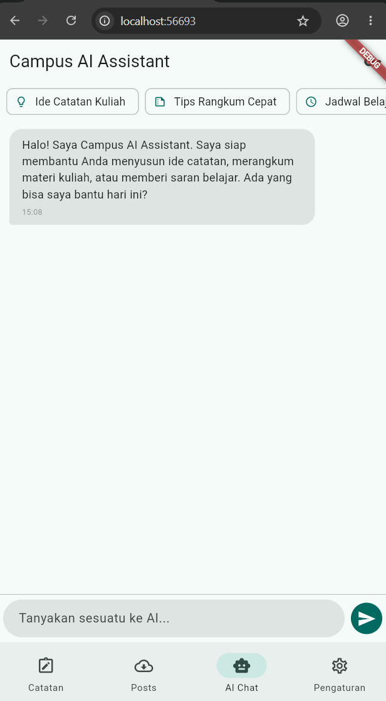
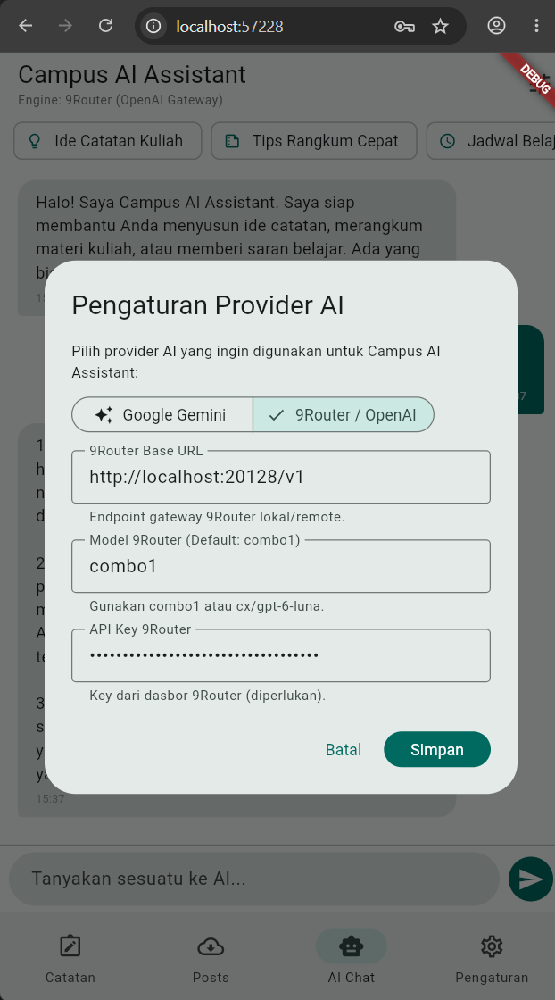
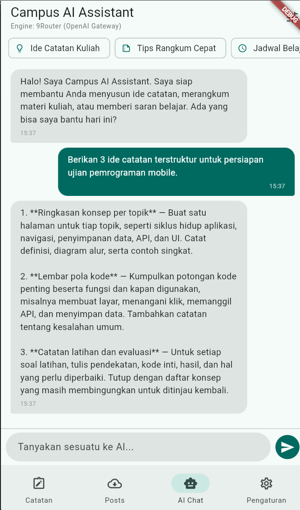
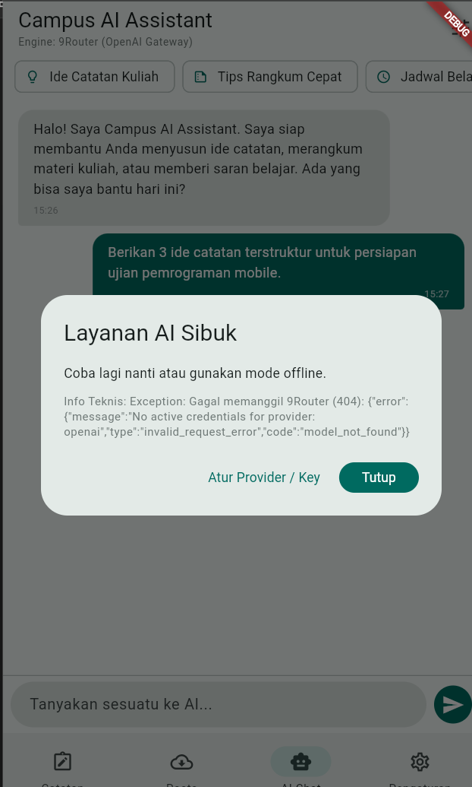

# Screenshots Panduan Pengujian Fitur AI — Week 10

Dokumentasi visual implementasi modul praktikum **#10 | Integrasi Fitur AI** (*Campus AI Assistant*).

---

## 📸 Galeri Tangkapan Layar Pengujian

| 1. Tampilan Chat Awal & Quick Prompts | 2. Dialog Pengaturan Provider / API Key |
|:---:|:---:|
|  |  |
| *Sambutan awal AI & quick prompt chips* | *Konfigurasi Engine & API Key (Terenkripsi)* |

 

| 3. Respon Percakapan AI Berhasil | 4. Fallback Dialog / Layanan Sibuk |
|:---:|:---:|
|  |  |
| *Interaksi tanya-jawab akademik terstruktur* | *Penanganan error ramah pengguna (mode offline)* |

---

## Keterangan Pengujian

1. **`01_chat_interface_awal.png`**:
   - Menampilkan antarmuka obrolan `Campus AI Assistant`.
   - Chip prompt cepat (*Ide Catatan Kuliah*, *Tips Rangkum Cepat*, *Jadwal Belajar*) untuk memudahkan interaksi awal mahasiswa.
   - Sambutan ramah awal dari asisten.

2. **`02_api_key_dialog.png`**:
   - Pilihan provider ganda: **Google Gemini** dan **9Router (OpenAI Gateway)**.
   - Pengaturan Base URL, Model default (`combo1`), dan API Key.
   - Kunci disimpan aman menggunakan `FlutterSecureStorage` (enkripsi hardware perangkat).

3. **`03_chat_response.png`**:
   - Menampilkan pengiriman pesan prompt mahasiswa: *"Berikan 3 ide catatan terstruktur untuk persiapan ujian pemrograman mobile."*
   - Respon AI terformat rapi dengan poin-poin terstruktur: *1. Ringkasan konsep per topik*, *2. Lembar pola kode*, dan *3. Catatan latihan dan evaluasi*.

4. **`04_fallback_dialog.png`**:
   - Menampilkan dialog fallback ramah saat jaringan terputus, API key belum valid, atau kuota habis: *"Layanan AI Sibuk. Coba lagi nanti atau gunakan mode offline."*
   - Memenuhi standar evaluasi mitigasi error modul praktikum tanpa membuat aplikasi *crash*.
