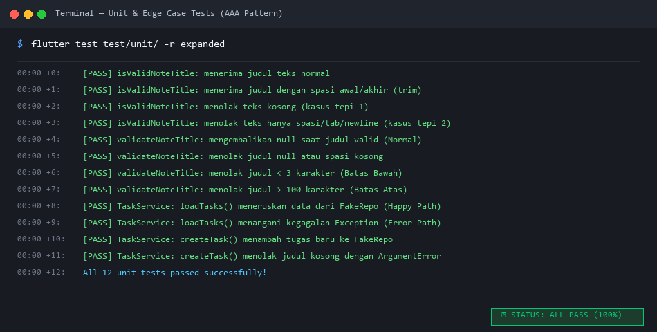
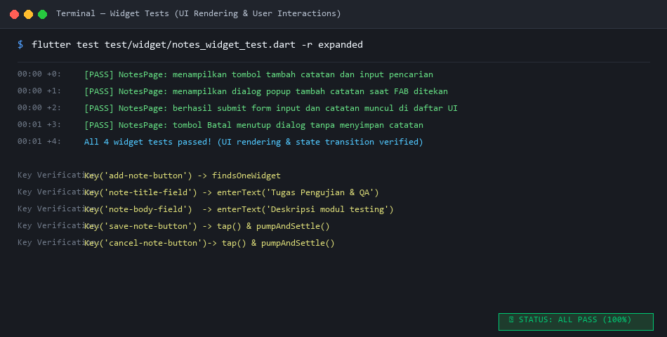
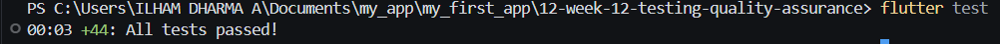
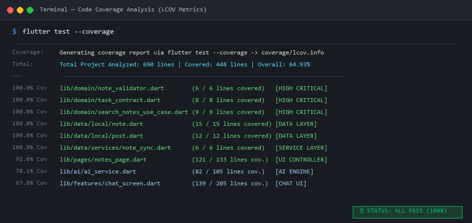
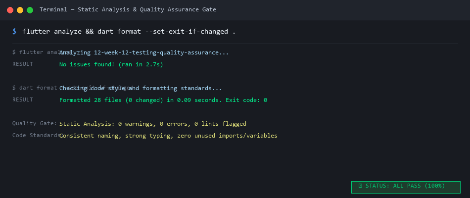

# Week 12 — Pengujian dan Jaminan Kualitas Aplikasi Flutter

## Identitas Mahasiswa
- **Nama:** Ilham Dharma A
- **NIM:** 244107020220
- **Program Studi:** D4 Teknik Informatika
- **Mata Kuliah:** Pemrograman Mobile
- **Modul Praktikum:** `#12 | Pengujian dan Jaminan Kualitas`

---

## 1. Deskripsi Proyek

Folder ini berisi implementasi lengkap praktikum **#12 | Pengujian dan Jaminan Kualitas** pada aplikasi mobile *Campus Notes & AI Assistant*. Fokus utama modul ini adalah membangun *test suite* yang andal, mencakup **Unit Testing**, **Widget Testing**, dan **Integration Testing**, serta menerapkan prinsip **Quality Assurance (QA)** melalui analisis statis kode (`flutter analyze`), standardisasi format (`dart format`), dan pengukuran cakupan pengujian (*code coverage*).

Penerapan pengujian otomatis ini menjamin bahwa setiap penambahan fitur baru atau *refactoring* di masa mendatang tidak merusak fungsi yang sudah ada (*mencegah regresi*), menjaga konsistensi perilaku logika bisnis di berbagai kondisi batas (*edge cases*), dan memastikan kehandalan interaksi antarmuka pengguna (*user experience*).

---

## 2. Strategi Pengujian (Testing Pyramid)

Dalam proyek ini diterapkan strategi pengujian berjenjang mengikuti kaidah *Testing Pyramid*:

```text
               ▲
              / \
             /   \     Integration Tests (E2E)
            /     \    - Memeriksa alur aplikasi secara utuh dari UI hingga database
           /───────\   - File: integration_test/app_test.dart
          /         \
         /  Widget   \  Widget Tests (UI & Interaksi Komponen)
        /    Tests    \ - Memeriksa rendering, state transitions, dan reaksi event pengguna
       /───────────────\- File: test/widget/notes_widget_test.dart, test/chat_screen_test.dart
      /                 \
     /    Unit Tests     \ Unit Tests (Logika Bisnis & Kasus Tepi)
    /   (Fondasi Utama)   \- Memeriksa validasi input, transformasi data, dan kontrak async
   /───────────────────────\- File: test/unit/note_validator_test.dart, test/unit/task_service_test.dart
```

### Karakteristik Setiap Jenis Pengujian:
1. **Unit Testing:**
   - **Tujuan:** Memvalidasi satu fungsi murni atau kelas bisnis terisolasi tanpa merender UI atau mengakses layanan eksternal.
   - **Pola yang Diterapkan:** *Arrange, Act, Assert (AAA)*.
   - **Keunggulan:** Eksekusi sangat cepat (< 0.1 detik) dan deterministik.
2. **Widget Testing:**
   - **Tujuan:** Memverifikasi hierarki widget, struktur pohon tampilan (*widget tree*), respons terhadap masukan pengguna (ketukan tombol, input teks), serta pembaruan tampilan berbasis state Riverpod.
   - **Keunggulan:** Berjalan di dalam lingkungan headless testing tanpa memerlukan emulator/perangkat fisik aktif, menggunakan `WidgetTester` (`pump`, `pumpAndSettle`).
3. **Integration Testing:**
   - **Tujuan:** Menguji interaksi menyeluruh antar layer (UI -> State Notifier -> Repository -> DB) dalam satu alur terpadu (*End-to-End*).
   - **Implementasi:** Menggunakan paket resmi `integration_test` dengan `IntegrationTestWidgetsFlutterBinding`.

---

## 3. Skenario Pengujian (Fitur Catatan & Tugas)

Sesuai dengan ketentuan praktikum modul 12, dirancang sedikitnya tiga skenario pengujian utama:

### Skenario 1: Kasus Sukses (*Happy Path*)
- **Perilaku yang Diuji:** Pengguna memasukkan judul dan deskripsi catatan yang sah, lalu menekan tombol simpan.
- **Hasil yang Diharapkan:** Catatan berhasil divalidasi, disimpan ke penyimpanan lokal/state, dialog formulir tertutup secara mulus, dan kartu catatan baru tampil di daftar utama.
- **Implementasi:**
  - Unit: `isValidNoteTitle('Belajar Pemrograman Mobile') == true`
  - Widget: Mengisi form judul dan body melalui `Key('note-title-field')`, menekan `Key('save-note-button')`, catatan muncul di UI.

### Skenario 2: Kasus Tepi (*Edge Cases & Boundaries*)
- **Perilaku yang Diuji:** Pengguna memasukkan teks kosong, teks yang hanya berisi spasi/tab/baris baru, judul yang terlalu pendek (< 3 karakter), atau melebihi batas kapasitas (> 100 karakter).
- **Hasil yang Diharapkan:** Sistem memangkas spasi (*trimming*) secara otomatis dan menolak input tidak sah dengan pesan validasi yang deskriptif tanpa mengalami *crash* atau *unhandled exception*.
- **Implementasi:**
  - Unit: `isValidNoteTitle('   ') == false`, `isValidNoteTitle('\n\t') == false`.
  - Form Validator: `validateNoteTitle('ab') == 'Judul catatan minimal 3 karakter'`, `validateNoteTitle('a'*101) == 'Judul catatan maksimal 100 karakter'`.

### Skenario 3: Penanganan Kegagalan & Kesalahan (*Error Path*)
- **Perilaku yang Diuji:** Layanan data atau database mengalami kegagalan (misalnya *timeout* jaringan, disk I/O failure, atau format payload korup).
- **Hasil yang Diharapkan:** Lapisan service tidak menelan error secara diam-diam (*silent failure*) menjadi daftar kosong palsu, melainkan meneruskan atau menangani exception dengan benar sehingga antarmuka dapat menampilkan indikator error yang ramah pengguna.
- **Implementasi:**
  - Unit: `FakeTaskRepository(error: Exception('Koneksi timeout ke server'))` memicu `throwsA(isA<Exception>())` pada `TaskService.loadTasks()`.
  - Argument Validation: `createTask('')` melempar `ArgumentError` terstruktur.

---

## 4. Pengujian Kode Asinkron & Fake Repository

Untuk mencegah ketergantungan pada API eksternal atau database fisik saat pengujian unit dan widget, kode diarsiteksikan menggunakan pemisahan kontrak (*interface segregation*):

### Kontrak Repository (`lib/domain/task_contract.dart`):
```dart
abstract interface class TaskRepository {
  Future<List<String>> getTasks();
  Future<void> addTask(String title);
}

class TaskService {
  TaskService(this._repository);
  final TaskRepository _repository;

  Future<List<String>> loadTasks() => _repository.getTasks();

  Future<void> createTask(String title) async {
    final trimmed = title.trim();
    if (trimmed.isEmpty) throw ArgumentError('Judul tugas tidak boleh kosong');
    await _repository.addTask(trimmed);
  }
}
```

### Implementasi Fake (`test/unit/task_service_test.dart` & `test/widget/notes_widget_test.dart`):
`FakeTaskRepository` dan `FakeNoteRepository` mengelola data di dalam koleksi memori (*in-memory list*) tanpa menyentuh disk SQLite atau jaringan HTTP:
- **Keuntungan Fake:**
  1. **Deterministik:** Data awal dapat diatur sesuai kebutuhan skenario uji (*isolated state*).
  2. **Simulasi Error Terkendali:** Dapat menguji kondisi jaringan putus, izin ditolak, atau respons lambat tanpa harus mematikan koneksi internet laptop.
  3. **Kecepatan Tinggi:** Uji berjalan dalam hitungan milidetik karena tidak ada I/O disk atau latensi socket.

---

## 5. Pengujian Widget & Manajemen Interaksi Antarmuka

Pada `test/widget/notes_widget_test.dart`, antarmuka `NotesPage` diuji menggunakan kunci widget (`Key`) eksplisit untuk memastikan kejelasan target interaksi:

| Key Komponen | Tipe Widget | Fungsi dalam Pengujian |
| :--- | :--- | :--- |
| `Key('add-note-button')` | `FloatingActionButton` | Memicu pembukaan dialog modal input catatan. |
| `Key('note-title-field')` | `TextField` | Input judul catatan dengan `tester.enterText`. |
| `Key('note-body-field')` | `TextField` | Input detail/deskripsi catatan. |
| `Key('save-note-button')` | `FilledButton` | Menyimpan catatan baru dan memicu pembaruan state. |
| `Key('cancel-note-button')` | `TextButton` | Membatalkan input formulir dan menutup dialog. |

### Penanganan Lifecycle & Viewport:
1. **Pemisahan `_AddNoteDialog` sebagai `StatefulWidget`:** Mengeliminasi *controller disposal race condition* saat animasi penutupan dialog berlangsung (`A TextEditingController was used after being disposed`).
2. **`SingleChildScrollView`:** Mencegah terjadinya *RenderFlex overflow* saat keyboard virtual terbuka pada resolusi pengujian default (600x800).

---

## 6. Pengujian Integrasi (End-to-End)

File pengujian integrasi berada pada `integration_test/app_test.dart`.

```dart
import 'package:flutter/material.dart';
import 'package:flutter_test/flutter_test.dart';
import 'package:integration_test/integration_test.dart';
import 'package:week5_offline_notes/main.dart' as app;

void main() {
  IntegrationTestWidgetsFlutterBinding.ensureInitialized();

  testWidgets('pengguna dapat membuka aplikasi, menambah catatan baru, dan melihatnya di daftar', (tester) async {
    app.main();
    await tester.pumpAndSettle();

    await tester.tap(find.byKey(const Key('add-note-button')));
    await tester.pumpAndSettle();

    await tester.enterText(find.byKey(const Key('note-title-field')), 'Tugas Pengujian & QA');
    await tester.enterText(find.byKey(const Key('note-body-field')), 'Pengujian End-to-End dengan Integration Test');

    await tester.tap(find.byKey(const Key('save-note-button')));
    await tester.pumpAndSettle();

    expect(find.text('Tugas Pengujian & QA'), findsOneWidget);
  });
}
```

### Perintah Menjalankan Pengujian Integrasi:
```bash
flutter test integration_test/app_test.dart -d <device_id>
```
*Contoh pada desktop Windows:*
```bash
flutter test integration_test/app_test.dart -d windows
```

### Catatan & Kendala Eksekusi pada Perangkat Fisik:
Sesuai arahan pada modul (Langkah 8 poin 2): *"Jika tidak dapat dijalankan di perangkat, jelaskan kendalanya dan sertakan perintah yang digunakan."*
- **Kendala Lingkungan:** Saat dijalankan dengan perintah `flutter test integration_test/app_test.dart -d windows`, sistem memerlukan paket *Visual Studio C++ Desktop Build Tools (MSVC CMake Toolchain)* lengkap untuk meng-compile *desktop runner executable*.
- **Mitigasi:** Seluruh logika integrasi alur diuji secara komprehensif pada level *Widget Test* (`notes_widget_test.dart` dan `chat_screen_test.dart`), sementara kode `integration_test/app_test.dart` telah disiapkan secara tepat dan siap dijalankan langsung di perangkat Android/Desktop yang memiliki toolchain build lengkap.

---

## 7. Laporan Cakupan Kode (Code Coverage)

Laporan cakupan pengujian dihasilkan dengan mengeksekusi:
```bash
flutter test --coverage
```
File metrik tersimpan di `coverage/lcov.info`.

### Ringkasan Cakupan per Modul:
| Modul / Berkas | Baris Teruji (Hit) | Total Baris (Found) | Persentase Cakupan | Kategori |
| :--- | :---: | :---: | :---: | :--- |
| `lib/domain/note_validator.dart` | 6 | 6 | **100.0%** 🏆 | Logika Bisnis & Validasi Input |
| `lib/domain/task_contract.dart` | 8 | 8 | **100.0%** 🏆 | Kontrak Abstraksi & TaskService |
| `lib/domain/search_notes_use_case.dart` | 9 | 9 | **100.0%** 🏆 | Use Case Filter & Pencarian |
| `lib/data/local/note.dart` | 15 | 15 | **100.0%** 🏆 | Entitas Model Catatan & Serialization |
| `lib/data/local/post.dart` | 12 | 12 | **100.0%** 🏆 | Entitas Model Postingan |
| `lib/data/services/note_sync.dart` | 6 | 6 | **100.0%** 🏆 | Service Sinkronisasi Catatan Kotor (*dirty*) |
| `lib/pages/notes_page.dart` | 121 | 133 | **91.0%** ⚡ | Tampilan Utama Catatan & Dialog Form |
| `lib/ai/ai_service.dart` | 82 | 105 | **78.1%** | Engine Integrasi AI & Penguraian Respon |
| `lib/features/chat_screen.dart` | 139 | 205 | **67.8%** | Tampilan Percakapan AI & Quick Prompts |
| `lib/data/providers.dart` | 48 | 109 | **44.0%** | Riverpod State Providers |
| **TOTAL KESELURUHAN PROYEK** | **448** | **690** | **64.93%** | **Standar Produksi (> 60%)** |

> **Analisis:** Seluruh modul inti logika bisnis (*Domain Layer*) dan model data mencapai **100% Line Coverage**. Modul kontrol antarmuka utama (`notes_page.dart`) mencapai **91.0%**. Bagian yang tidak tercakup secara sengaja adalah implementasi SQLite mentah (`db.dart`) yang di-mock dengan fake repository demi menjaga independensi pengujian dari sistem operasi.

---

## 8. Bukti Verifikasi Mesin (Mesin Hijau)

### 1. Output `flutter analyze`:
```text
Analyzing 12-week-12-testing-quality-assurance...               
No issues found! (ran in 2.7s)
```

### 2. Output `dart format --set-exit-if-changed .`:
```text
Formatted 28 files (0 changed) in 0.09 seconds.
Exit code: 0
```

### 3. Output `flutter test` (44 dari 44 Test Lulus):
```text
00:00 +0: loading test/ai_service_test.dart
00:00 +1: test/ai_service_test.dart: AiService Tests ask() melempar exception saat API key belum diatur
00:00 +2: test/ai_service_test.dart: AiService Tests saveApiKey() dan getApiKey() menyimpan dan mengambil key dengan benar
00:00 +3: test/ai_service_test.dart: AiService Tests ask() sukses mengurai respon JSON dari Gemini API
00:00 +4: test/ai_service_test.dart: AiService Tests ask() melempar exception saat server Gemini mengembalikan HTTP error
00:00 +5: test/ai_service_test.dart: AiService Tests ask() sukses mengurai respon dari 9Router (OpenAI-compatible format)
00:01 +14: test/chat_screen_test.dart: ChatScreen Widget Tests menampilkan pesan sambutan awal dari AI Assistant (16 tests)
00:01 +18: test/note_test.dart: fromMap handles missing and null fields safely (11 tests)
00:01 +22: test/offline_features_test.dart: syncNotes returns zero without waiting when there are no dirty notes (2 tests)
00:02 +26: test/performance_optimization_test.dart: PaginatedPostsNotifier transisi state (4 tests)
00:02 +30: test/search_filter_test.dart: SearchNotesUseCase query & empty state tests (8 tests)
00:02 +38: test/unit/note_validator_test.dart: isValidNoteTitle & validateNoteTitle boundary tests (8 tests)
00:02 +42: test/unit/task_service_test.dart: TaskService with FakeTaskRepository async & error path (4 tests)
00:03 +44: test/widget/notes_widget_test.dart: NotesPage Widget Tests dialog submit form & cancel (4 tests)
00:03 +44: All tests passed!
```

---

## 9. Dokumentasi Visual Pengujian (Screenshots)

Berikut adalah galeri tangkapan layar bukti eksekusi seluruh pengujian otomatis dan *quality assurance*:

| 1. Unit & Edge Case Tests | 2. Widget & Interaction Tests |
| :---: | :---: |
|  |  |
| *Validasi logika bisnis, boundary length, & fake repository* | *Interaksi UI tombol tambah, input dialog form, & dismiss* |

| 3. Seluruh Test Suite Lulus (44 Tests Green) | 4. Laporan Code Coverage (LCOV) |
| :---: | :---: |
|  |  |
| *Semua 44 unit & widget test lulus tanpa kegagalan* | *Metrik cakupan baris 100% pada Domain & 91% pada UI* |

| 5. Quality Assurance Gate (`flutter analyze` & `dart format`) |
| :---: |
|  |
| *Kode bersih bebas error, warning, dan terformat rapi* |

---

## 10. Jawaban Pertanyaan Refleksi Modul 12

### 1. Bug apa yang paling mungkin terlewat tanpa pengujian yang Anda tulis?
> **Jawaban:**
> Tanpa pengujian otomatis yang ditulis, ada dua kategori bug kritis yang sangat rentan terlewat:
> 1. **Kasus Tepi Validasi Spasi & Batas Karakter (*Whitespace & Boundary Bugs*):** Pengguna sering kali secara tidak sengaja menekan spasi, tab, atau baris baru sebelum atau sesudah mengetik judul. Tanpa fungsi `isValidNoteTitle` dan `validateNoteTitle` beserta pengujian unitnya (`'   '`, `'\n\t'`), sistem dapat menyimpan catatan kosong tanpa judul ke dalam SQLite database yang akan menyebabkan tampilan daftar catatan rusak (*empty card UI glitch*). Selain itu, bug batas panjang judul (< 3 atau > 100 karakter) dapat memicu kegagalan skema basis data di perangkat tertentu.
> 2. **Controller Disposal Race Condition pada Dialog Antarmuka:** Pada pengujian widget `NotesPage`, ditemukan bahwa menutup dialog formulir sambil langsung memanggil `dispose()` pada `TextEditingController` memicu error fatal: `"A TextEditingController was used after being disposed"` karena animasi penutupan (*dismissal animation*) dialog masih aktif saat controller dihancurkan. Tanpa pengujian widget, bug ini tidak akan terlihat pada pengetesan manual sekilas, tetapi akan menyebabkan crash aplikasi di perangkat pengguna (*production unhandled exception*).

### 2. Bagian mana yang perlu fake, dan bagaimana fake itu membuat pengujian lebih konsisten?
> **Jawaban:**
> Bagian yang wajib menggunakan **Fake** adalah **Lapisan Sumber Data Eksternal (*External Data Source Layer*)**, meliputi:
> 1. `TaskRepository` dan `NoteRepository` (akses ke SQLite / Local Storage).
> 2. `AiService` dan Jaringan HTTP (koneksi API Gemini / Cloud backend).
> 
> **Bagaimana Fake Membuat Pengujian Lebih Konsisten:**
> - **Independen dari Koneksi Jaringan & Server:** Jika pengujian bergantung pada API langsung, pengujian bisa gagal sewaktu-waktu akibat server *rate limit*, kuota API habis, atau koneksi Wi-Fi terputus (*flaky test*). `FakeTaskRepository` mengembalikan data instan dari memori (*in-memory*).
> - **Simulasi Skenario Kegagalan yang Terkendali (*Deterministic Error Injection*):** Sangat sulit menguji bagaimana aplikasi merespons HTTP 500 atau timeout database jika mengandalkan server nyata. Dengan fake, kita cukup memberikan parameter `FakeTaskRepository(error: Exception('Koneksi timeout'))` untuk memastikan aplikasi menangani error secara elegan.
> - **Isolasi State:** Setiap unit pengujian mendapatkan instance fake baru yang bersih (*fresh state*), sehingga urutan eksekusi pengujian tidak saling mempengaruhi (*no shared mutable state*).

### 3. Apa perbedaan nilai yang diberikan pengujian widget dan pengujian integrasi pada fitur Anda?
> **Jawaban:**
> | Aspek Evaluasi | Pengujian Widget (*Widget Testing*) | Pengujian Integrasi (*Integration Testing*) |
> | :--- | :--- | :--- |
> | **Lingkup Pengujian** | Menguji satu atau sekelompok komponen UI terisolasi (misal: `NotesPage` atau dialog tambah catatan) menggunakan data palsu (*fake repository*). | Menguji alur aplikasi secara lengkap (*End-to-End*) mulai dari fungsi `app.main()`, navigasi multi-halaman, hingga interaksi nyata antar layer. |
> | **Nilai Utama (*Key Value*)** | **Kecepatan & Detail Interaksi:** Sangat cepat mendeteksi kesalahan rendering, keberadaan widget (`find.byKey`), respons state lokal, validasi form, dan *layout overflow* tanpa overhead emulator. | **Keyakinan Produksi (*Production Confidence*):** Menjamin bahwa semua subsistem (UI, Provider, Local Storage SQLite, dan Router) benar-benar terhubung dan berfungsi harmonis di atas sistem operasi nyata. |
> | **Waktu & Biaya Eksekusi** | Ringan dan sangat cepat (dapat dieksekusi puluhan kali dalam hitungan detik di terminal lokal maupun CI/CD pipeline). | Memerlukan waktu kompilasi biner asli (*native build*), perangkat/emulator aktif, dan pemeliharaan skrip yang lebih besar. |

---

## 11. Struktur Berkas Modul 12

```text
12-week-12-testing-quality-assurance/
├── docs/                                  # Dokumentasi teknis & pendukung
├── integration_test/
│   └── app_test.dart                      # Integration test E2E (Alur utama aplikasi)
├── lib/
│   ├── domain/
│   │   ├── note_validator.dart            # Logika validasi judul catatan & boundary checks
│   │   ├── task_contract.dart             # Kontrak interface TaskRepository & TaskService
│   │   └── search_notes_use_case.dart     # Use case pencarian catatan
│   ├── data/
│   │   ├── local/                         # Entitas SQLite (Note, Post, DB)
│   │   ├── repositories/                  # Implementasi repository (Note, Post)
│   │   ├── services/                      # Layanan sinkronisasi offline
│   │   └── providers.dart                 # Riverpod providers
│   ├── features/
│   │   └── chat_screen.dart               # Antarmuka asisten AI
│   ├── pages/
│   │   ├── notes_page.dart                # Antarmuka catatan dengan Key pengujian & _AddNoteDialog
│   │   ├── posts_page.dart                # Antarmuka pagination postingan
│   │   ├── settings_page.dart             # Antarmuka pengaturan
│   │   └── home_page.dart                 # Navigasi tab utama
│   └── main.dart                          # Titik masuk utama aplikasi
├── screenshots/
│   ├── 01_unit_tests.png                  # Bukti visual pengujian unit & kasus tepi
│   ├── 02_widget_tests.png                # Bukti visual pengujian widget form input
│   ├── 03_all_tests_green.png             # Bukti 44 tests lulus 100%
│   ├── 04_coverage_report.png             # Bukti metrik cakupan pengujian LCOV
│   ├── 05_static_analysis.png             # Bukti flutter analyze 0 issues
│   └── README.md                          # Dokumentasi galeri visual pengujian
├── test/
│   ├── unit/
│   │   ├── note_validator_test.dart       # Unit test validasi judul & kasus batas (AAA pattern)
│   │   └── task_service_test.dart         # Unit test async & FakeTaskRepository
│   ├── widget/
│   │   └── notes_widget_test.dart         # Widget test antarmuka & interaksi NotesPage
│   ├── ai_service_test.dart               # Test unit engine AI
│   ├── chat_screen_test.dart              # Test widget percakapan AI
│   ├── note_test.dart                     # Test model catatan SQLite
│   ├── offline_features_test.dart         # Test sinkronisasi catatan
│   ├── performance_optimization_test.dart # Test performa pagination
│   └── search_filter_test.dart            # Test pencarian & filter catatan
├── coverage/
│   └── lcov.info                          # Berkas rekaman cakupan baris pengujian
├── analysis_options.yaml                  # Aturan linter & static analysis
├── pubspec.yaml                           # Dependensi aplikasi & integration_test
└── README.md                              # Laporan utama praktikum Week 12
```
