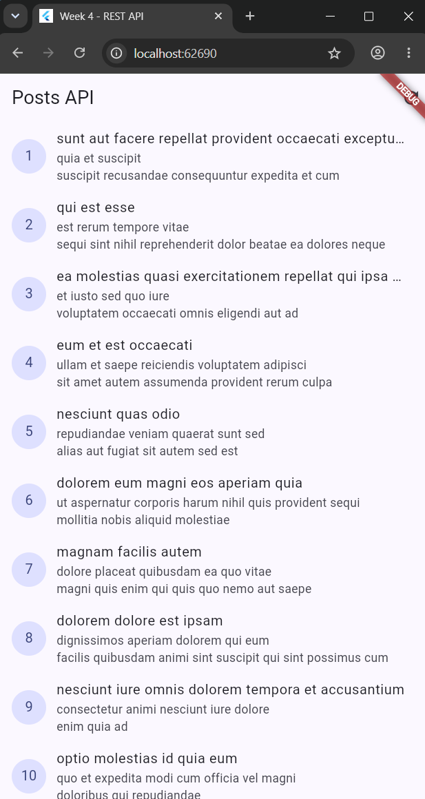
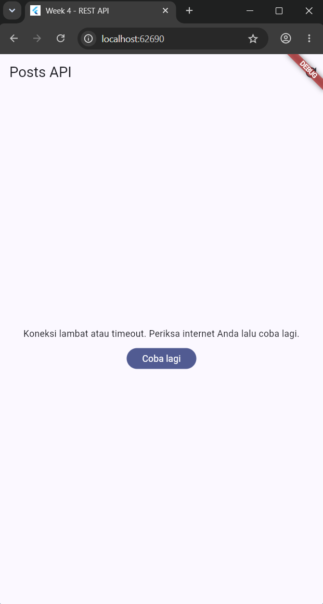
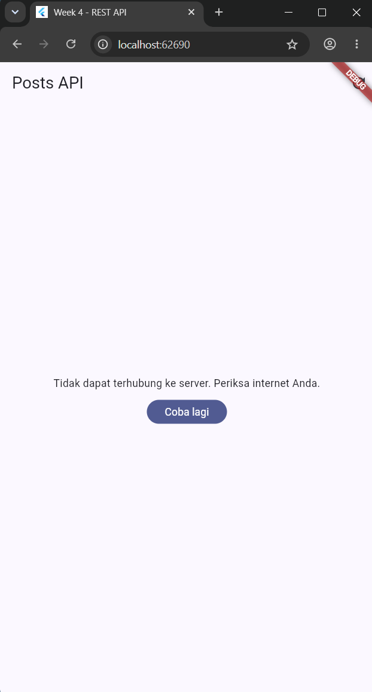
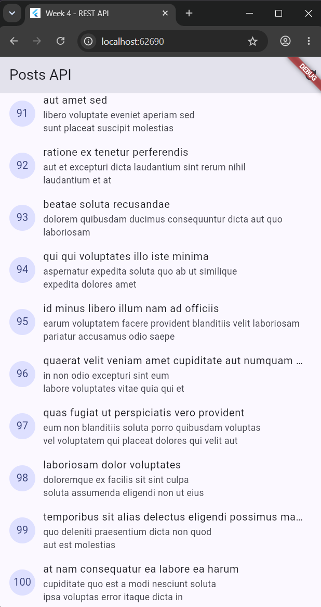
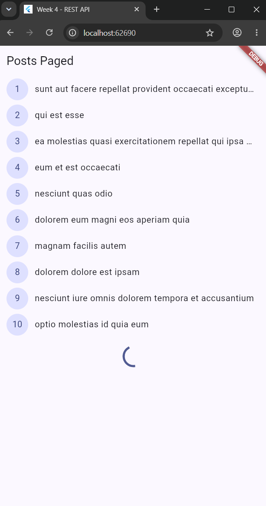

# Week 4 - Networking & REST API

> **Dio, Riverpod, GoRouter, dan Unit Testing Offline**

[](https://flutter.dev/)
[](https://pub.dev/packages/dio)
[](https://riverpod.dev/)
[](https://pub.dev/packages/go_router)
[](#hasil-pengujian--verifikasi)
[](#hasil-pengujian--verifikasi)

Project praktikum Week 4 berupa aplikasi Flutter untuk konsumsi REST API
[JSONPlaceholder](https://jsonplaceholder.typicode.com/) melalui endpoint
`/posts` dan `/comments`. Project ini menggunakan arsitektur modular dengan
repository pattern, penanganan error jaringan terpusat, pagination berbasis
infinite scroll, navigasi deklaratif, dan unit testing offline menggunakan mock
repository.

> **Lokasi project:** implementasi saat ini berada di folder `week4_api`. Folder
> portofolio `04-week-4-networking-rest-api` dapat digunakan sebagai nama folder
> pengumpulan tanpa mengubah struktur kode di dalamnya.

## Tujuan Pembelajaran

- Memahami konsep HTTP dan REST API dalam aplikasi Flutter.
- Membuat parsing model yang aman terhadap field hilang, `null`, dan tipe data
	yang tidak konsisten dengan prinsip null-safety.
- Menerapkan repository pattern dasar untuk memisahkan UI dari akses data.
- Membuat konfigurasi Dio terpusat melalui API client.
- Mengelola empat kondisi UI menggunakan `AsyncValue` Riverpod: loading, error,
	empty, dan data/success.
- Menerapkan pagination dasar dengan `_page`, `_limit`, dan infinite scroll.
- Membuat unit test deterministik tanpa koneksi internet.

## Stack Teknologi

| Lapisan | Teknologi | Peran |
| --- | --- | --- |
| Framework | Flutter SDK / Dart | UI lintas platform dan bahasa pemrograman |
| HTTP client | Dio | Request REST API, timeout, dan `DioException` |
| State management | `flutter_riverpod` | Manual `AsyncNotifier` dan `AsyncValue`, tanpa code generator |
| Routing | `go_router` | Rute aplikasi dan parameter dinamis |
| Backend latihan | JSONPlaceholder | Data posts dan comments |
| Testing | `flutter_test` | Unit test model, error mapping, dan provider |

## Arsitektur & Fitur Utama

### Repository Pattern

UI tidak memanggil Dio secara langsung. Alur data dibuat satu arah agar setiap
lapisan memiliki tanggung jawab yang jelas:

```text
ConsumerWidget / ConsumerStatefulWidget
							│
							▼
Provider (AsyncValue / AsyncNotifier)
							│
							▼
Repository (PostRepository / CommentRepository)
							│
							▼
Dio Client (konfigurasi base URL dan timeout)
							│
							▼
REST API JSONPlaceholder
```

### Error Handling Ramah Pengguna

Pemetaan error jaringan dipusatkan di `lib/data/network_errors.dart` melalui
fungsi `friendlyErrorMessage`. Beberapa kondisi yang ditangani:

| `DioException` | Respons UI |
| --- | --- |
| `connectionTimeout`, `sendTimeout`, `receiveTimeout` | Pesan koneksi lambat atau timeout |
| `connectionError` | Pesan bahwa server tidak dapat dihubungi |
| `badResponse` `404` | Pesan data tidak ditemukan |
| `badResponse` `500` atau status lain | Pesan server bermasalah dan saran mencoba lagi |

### Empat Kondisi UI

- [x] **Loading:** menampilkan `CircularProgressIndicator` ketika request sedang
	berlangsung.
- [x] **Error:** menampilkan pesan ramah dan tombol **Coba lagi** atau retry.
- [x] **Empty:** menampilkan informasi ketika API mengembalikan list kosong.
- [x] **Data/Success:** menampilkan `ListView` dan `RefreshIndicator` untuk
	memuat ulang data dengan pull-to-refresh.

### Pagination dengan Infinite Scroll

`PagedPostPage` menggunakan `ScrollController` untuk mendeteksi posisi mendekati
batas bawah list. Request berikutnya mengambil data berdasarkan `_page` dan
`_limit`, lalu menggabungkannya ke list sebelumnya. Guard request ganda mencegah
load bersamaan melalui state `isLoadingMore`, sedangkan `hasMore` menghentikan
request ketika jumlah item menandakan seluruh data sudah dimuat.

### Refactoring & Navigasi

- `PostTile` mengekstraksi tampilan satu baris post agar `ListView` lebih bersih
	dan komponen lebih mudah digunakan kembali.
- GoRouter mendaftarkan rute dinamis `/post/:id` menuju `PostDetailPage`.
- Parameter `id` dari URL dikonversi menjadi `postId` untuk menampilkan judul dan
	isi post yang dipilih.

### AI Challenge: Comments

Fitur komentar meliputi model `Comment` yang aman terhadap data `null`,
`CommentRepository` untuk endpoint `/comments?postId={id}`, serta provider
komentar berbasis `postId` yang mengekspos state asynchronous kepada UI.

## Struktur Proyek

```text
04-week-4-networking-rest-api/       # nama folder portofolio
├── lib/
│   ├── main.dart
│   ├── data/
│   │   ├── api_client.dart
│   │   ├── network_errors.dart
│   │   ├── paged_posts.dart
│   │   ├── providers.dart
│   │   ├── comment_providers.dart
│   │   ├── models/
│   │   │   ├── post.dart
│   │   │   └── comment.dart
│   │   └── repositories/
│   │       ├── post_repository.dart
│   │       └── comment_repository.dart
│   ├── pages/
│   │   ├── post_list_page.dart
│   │   ├── paged_post_page.dart
│   │   └── post_detail_page.dart
│   └── widgets/
│       └── post_tile.dart
├── test/
│   ├── post_test.dart
│   └── comment_model_test.dart
├── docs/                            # Dokumentasi tambahan
├── screenshot/                      # Screenshot aplikasi yang didokumentasikan
├── pubspec.yaml
└── README.md
```

## Galeri Screenshot

Screenshot aplikasi yang disediakan berada di folder `screenshot/` (singular).
Nama file dibuat tanpa spasi agar path relatif berfungsi konsisten pada GitHub.

### 1. Daftar posts berhasil dimuat

Halaman **Posts API** menampilkan hasil dari endpoint `/posts`, termasuk judul
dan isi ringkas setiap post.



### 2. Kondisi timeout

Ketika request terlalu lama, UI menampilkan pesan timeout yang ramah dan tombol
**Coba lagi**.



### 3. Kondisi koneksi gagal

Saat aplikasi tidak dapat terhubung ke server, UI menampilkan pesan koneksi
gagal dan menyediakan tombol retry.



### 4. Daftar posts setelah berhasil dimuat

Screenshot ini juga memperlihatkan daftar post setelah request berhasil.


### 5. Bagian bawah daftar posts

Tangkapan layar memperlihatkan item bernomor 91–100 di bagian bawah daftar.



### 6. Pagination sedang memuat

Halaman **Posts Paged** menampilkan item 1–10 dan indikator loading di bawah
daftar, yang menunjukkan request halaman berikutnya sedang berlangsung.
Screenshot ini membuktikan state loading pagination; tidak digunakan sebagai
bukti bahwa halaman berikutnya sudah selesai dimuat.



Screenshot loading awal, halaman detail `/post/:id`, dan hasil terminal test
tidak tersedia di folder screenshot yang diberikan, sehingga tidak ditambahkan
sebagai bukti gambar.

## Hasil Pengujian & Verifikasi

Status verifikasi project:

- [x] `flutter analyze` - **No issues found!** (**0 issues**)
- [x] `flutter test` - **+6: All tests passed!**
- [x] Unit test model `Comment` yang aman terhadap field hilang dan nilai `null`.
- [x] Unit test model `Post` dengan default `userId: 0` ketika field tidak ada.
- [x] Unit test pemetaan `DioExceptionType.connectionError` ke pesan ramah.
- [x] Dua pengujian mock repository offline menggunakan
	`ProviderContainer.overrides`: skenario sukses dan skenario error.

Test provider menggunakan `FakePostRepository`, sehingga pengujian tidak
memanggil internet dan hasilnya tetap cepat, deterministik, serta dapat diulang.

## Refleksi Modul

### a. Mengapa UI dilarang memanggil Dio langsung?

Karena hal tersebut melanggar **Separation of Concerns**. Jika UI menangani
request HTTP, parsing, dan error sekaligus, logika bisnis bercampur dengan
tampilan dan widget menjadi sulit dipelihara. UI juga sulit diuji dengan unit
test karena test harus mengetahui detail jaringan. Repository memisahkan akses
data, sedangkan provider menerjemahkan hasilnya menjadi state yang siap dirender.

### b. Kapan pagination client-side cukup dan kapan harus server-side?

Pagination client-side cukup untuk data statis atau dataset kecil, misalnya
kurang dari sekitar 100 item, ketika seluruh data masih wajar disimpan di memori.
Pagination server-side dengan `_page` dan `_limit` wajib untuk data dinamis atau
dataset besar hingga ribuan entri. Pendekatan ini menghemat bandwidth, waktu
request, dan RAM perangkat karena hanya data yang dibutuhkan yang dikirim.

### c. Bagaimana exception repository berubah menjadi `AsyncError`?

Method `build` pada `AsyncNotifier` mengembalikan `Future`. Riverpod membungkus
Future tersebut dan secara otomatis mengubah hasilnya menjadi `AsyncData` atau
exception menjadi `AsyncError`, sehingga setiap widget tidak perlu memiliki
`try/catch` sendiri. `try/catch` eksplisit tetap diperlukan pada aksi manual
seperti `refresh` atau `loadNextPage`, karena aksi tersebut memperbarui state
secara langsung dan perlu mempertahankan data lama saat request gagal.

### d. Bagian mana dari hasil AI yang diperbaiki?

Beberapa bagian disesuaikan agar lebih aman dan sesuai kebutuhan modul:

- Memastikan null-safety pada parsing JSON dengan operator fallback `??` untuk
	field yang hilang atau bernilai `null`.
- Menghilangkan kebutuhan code generator agar implementasi tetap menggunakan
	manual `AsyncNotifier` dan mudah dipelajari.
- Menyesuaikan signature provider dan repository dengan bentuk data, endpoint,
	serta alur state yang digunakan oleh modul.

## Cara Menjalankan Proyek & Pengujian

Jalankan semua perintah dari direktori `week4_api` atau folder portofolio yang
berisi `pubspec.yaml`.

### 1. Setup dependensi

```bash
flutter pub get
```

### 2. Menjalankan aplikasi

```bash
flutter run
```

Pastikan device Flutter tersedia dan koneksi internet aktif ketika aplikasi
mengambil data dari JSONPlaceholder.

### 3. Menjalankan pengujian

```bash
flutter test
flutter analyze
```

## Endpoint API

| Kebutuhan | Method dan endpoint |
| --- | --- |
| Daftar post | `GET /posts` |
| Pagination post | `GET /posts?_page={page}&_limit={limit}` |
| Komentar post | `GET /comments?postId={id}` |

Base URL: `https://jsonplaceholder.typicode.com`.

## Referensi Pendukung

1. [Dio package](https://pub.dev/packages/dio) - HTTP client untuk Dart dan Flutter.
2. [JSONPlaceholder API](https://jsonplaceholder.typicode.com/) - REST API publik untuk latihan.
3. [Riverpod: AsyncNotifier & AsyncValue](https://riverpod.dev/docs/concepts2/async_notifier) - State asynchronous tanpa code generator.
4. [Flutter Cookbook: Networking](https://docs.flutter.dev/cookbook/networking) - Panduan networking resmi Flutter.
5. [Dart in Y Minutes](https://learnxinyminutes.com/docs/dart/) - Ringkasan sintaks dan konsep dasar Dart.
