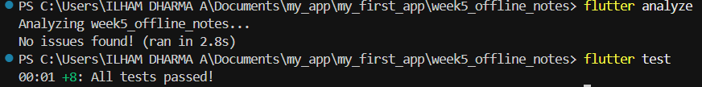
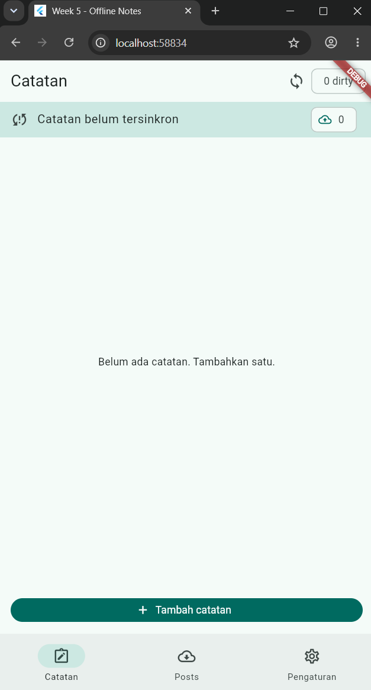
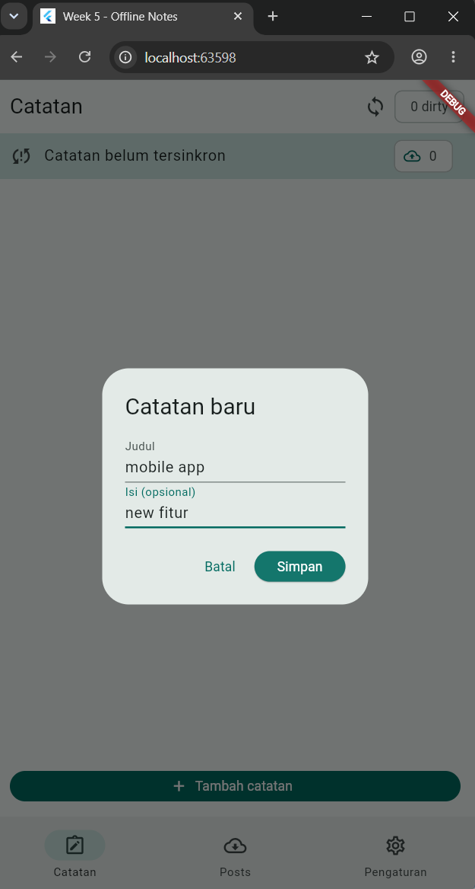
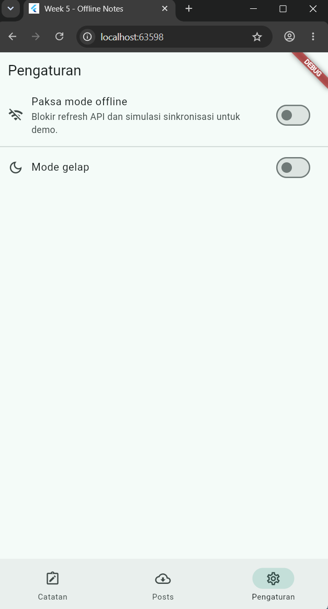
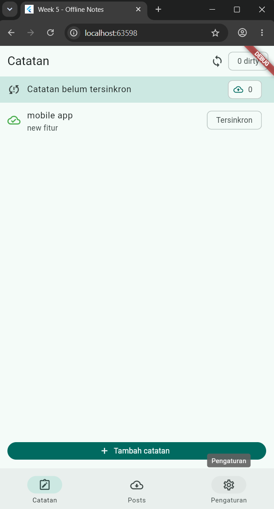
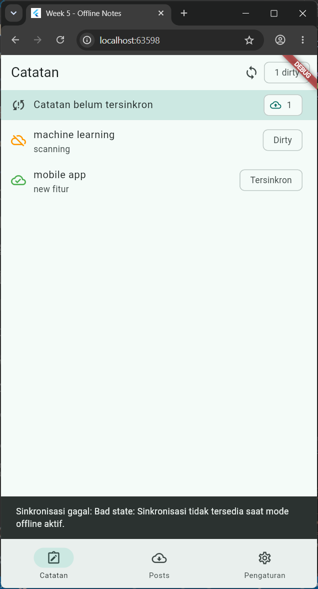

# Week 5 — Offline Notes

Laporan praktikum aplikasi Flutter untuk catatan lokal, cache-first API, dan
simulasi antrean sinkronisasi. Aplikasi tetap dapat menampilkan catatan ketika
offline; data API Posts disimpan sebagai cache lokal.

## Daftar isi

1. [Fitur dan alur aplikasi](#1-fitur-dan-alur-aplikasi)
2. [Penyimpanan dan sinkronisasi](#2-penyimpanan-dan-sinkronisasi)
3. [Menjalankan aplikasi dan pengujian](#3-menjalankan-aplikasi-dan-pengujian)
4. [Dokumentasi screenshot](#4-dokumentasi-screenshot)
6. [AI Challenge — perbandingan storage](#6-ai-challenge--perbandingan-storage)
7. [Refactoring, testing, dan error umum](#7-refactoring-testing-dan-error-umum)
8. [Catatan dan batasan implementasi](#catatan-dan-batasan-implementasi)
7. [Batasan implementasi](#7-batasan-implementasi)

## 1. Fitur dan alur aplikasi

- **Catatan lokal:** tambah dan baca catatan; tekan lama sebuah catatan untuk
  menghapusnya.
- **Status sinkronisasi:** catatan baru berstatus `Dirty`; penghitung di layar
  menunjukkan jumlah catatan yang menunggu sinkronisasi.
- **Posts cache-first:** data berasal dari
  `GET https://jsonplaceholder.typicode.com/posts`. Aplikasi membaca cache
  lokal dahulu, lalu refresh jaringan di background dan mengganti cache setelah
  refresh berhasil.
- **Mode offline paksa:** pengaturan ini menahan refresh Posts dan simulasi
  sinkronisasi sehingga skenario offline dapat diuji dengan konsisten tanpa
  mematikan Wi-Fi.
- **Preferensi tema:** pilihan mode gelap disimpan menggunakan
  SharedPreferences.

## 2. Penyimpanan dan sinkronisasi

### Catatan dan cache Posts

Catatan dan cache Posts disimpan melalui SQLite (`sqflite`). Tabel catatan
memiliki kolom:

| Kolom | Keterangan |
|---|---|
| `id` | ID lokal autoincrement. |
| `title`, `body` | Judul dan isi catatan. |
| `updated_at` | Waktu perubahan terakhir, disimpan sebagai ISO 8601. |
| `dirty` | `1` bila belum tersinkron, `0` bila bersih. |

Cache Posts disimpan dalam tabel `cached_posts`. Pada Flutter Web, proyek
menggunakan SQLite WASM dengan penyimpanan browser IndexedDB. File
`web/sqlite3.wasm` dan `web/sqflite_sw.js` dibutuhkan untuk menjalankannya;
buat ulang dengan:

```sh
dart run sqflite_common_ffi_web:setup
```

Penyimpanan browser terikat pada origin, termasuk nomor port. Jalankan kembali
dengan port yang sama untuk mengakses data browser sebelumnya. Android/iOS
menggunakan plugin SQLite native.

### Aturan sync dan konflik

Implementasi demo mensimulasikan upload selama satu detik; backend tulis belum
tersedia. Catatan dirty hanya ditandai bersih jika `updated_at` masih sama
dengan snapshot yang diambil saat sync dimulai. Dengan demikian, perubahan yang
terjadi selama sync tidak ikut ditandai tersinkron secara keliru.

Aturan konflik yang digunakan adalah **last-write-wins berdasarkan
`updated_at`**. Skema saat ini belum menyertakan retry counter atau tombstone
untuk penghapusan offline.

## 3. Menjalankan aplikasi dan pengujian

Jalankan perintah dari folder `week5_offline_notes`:

```sh
flutter pub get
flutter run
flutter analyze
flutter test
flutter build web
```

Untuk Flutter Web, pastikan aset SQLite Web telah disiapkan. Jika dependency
baru ditambahkan, hentikan aplikasi yang sedang berjalan lalu jalankan ulang
secara penuh.

### Hasil verifikasi

| Pemeriksaan | Hasil |
|---|---|
| `flutter analyze` | Lulus, tidak ada masalah analisis. |
| `flutter test` | Lulus, 8 tes pada dua file tes. |
| `flutter build web` | Lulus. |
| SQLite Web setup | Berhasil membuat `web/sqlite3.wasm` dan `web/sqflite_sw.js`. |

`test/note_test.dart` menguji fallback mapping saat field hilang/null,
serialisasi flag dirty, serta `notesProvider` dengan repository palsu untuk
kondisi sukses dan error. `test/offline_features_test.dart` adalah file tes
yang juga sudah ada di proyek; Flutter menjalankannya bersama tes lain saat
perintah `flutter test` digunakan.

#### Bukti hasil analyze dan test

Screenshot terminal berikut menunjukkan `flutter analyze` selesai tanpa
masalah dan `flutter test` berhasil (`All tests passed!`).



## 4. Dokumentasi screenshot

Screenshot berikut diambil dari aplikasi yang dijalankan di browser lokal.
Urutannya memperlihatkan kondisi awal, input catatan, pengaturan offline,
perilaku catatan saat offline, lalu kondisi sesudah sync.

### 4.1 Halaman catatan awal

Belum ada catatan tersimpan. Penghitung dirty bernilai nol.



### 4.2 Form tambah catatan

Dialog menyediakan judul dan isi opsional sebelum catatan disimpan.



### 4.3 Pengaturan mode offline

Mode offline dapat diaktifkan untuk menguji perilaku cache dan sync secara
deterministik.



### 4.4 Catatan saat offline

Screenshot memperlihatkan satu catatan berstatus `Dirty` dan satu catatan
`Tersinkron`. Banner di bawah menyatakan sync tidak tersedia saat mode offline
aktif; ini adalah hasil yang diharapkan untuk skenario tersebut.



### 4.5 Setelah sinkronisasi

Setelah mode offline dinonaktifkan dan sync selesai, penghitung dirty menjadi
nol dan catatan ditandai `Tersinkron`.



## 6. AI Challenge — perbandingan storage

### Prompt yang digunakan

```text
Aplikasi Flutter Offline Notes: CRUD catatan + preferensi tema.
Bandingkan SharedPreferences, Hive, sqflite (SQLite), dan Drift
untuk dua kebutuhan ini. Requirements:
- Kriteria: kompleksitas query, kebutuhan relasi, reaktivitas (stream),
  type-safety, ukuran boilerplate, dan kemudahan testing.
- Beri rekomendasi final: mana untuk preferensi, mana untuk catatan,
  beserta alasannya dalam 1 tabel.
- Tunjukkan skema tabel/kotak untuk 1000+ catatan.
Jelaskan trade-off setiap pilihan.
```

### Output awal AI dan verifikasi

AI awalnya merekomendasikan SharedPreferences untuk preferensi dan menyebut
Drift sebagai kandidat kuat untuk catatan karena query bertipe dan stream
`watch()`. SharedPreferences tidak direkomendasikan untuk menyimpan koleksi
catatan sebagai satu nilai JSON.

Perbandingan mendetail, trade-off, skema 1000+ catatan, dan checklist
verifikasinya ada di [docs/ai-challenge-storage.md](./docs/ai-challenge-storage.md).
Ringkasan hasil verifikasi:

- Daftar catatan tidak disimpan di SharedPreferences. Database menyimpan
  catatan per baris.
- Kolom `dirty` dan `updated_at` mendukung status serta sinkronisasi demo.
- sqflite tidak menyediakan stream query bawaan. Aplikasi menggunakan
  FutureProvider dan invalidasi setelah perubahan; Drift `watch()` belum
  digunakan.
- Keputusan akhir: **SharedPreferences untuk preferensi sederhana dan
  SQLite/sqflite untuk catatan**. Ini sesuai kebutuhan CRUD dan metadata sync,
  tanpa menambah biaya code generation Drift yang belum diperlukan.
- Verifikasi instalasi/migrasi Drift dan Hive tidak dilakukan. sqflite sudah
  digunakan proyek; setup tambahan yang diuji adalah backend SQLite Web.

## 7. Refactoring, testing, dan error umum

Challenge pada bagian ini membahas rute login/pengumuman, payload FCM,
autentikasi, dan error Dio. Itu adalah cakupan aplikasi `campus_notify`, bukan
fitur Offline Notes. Fondasi challenge dikerjakan pada proyek terpisah:

- Konstanta rute: [campus_notify/lib/routes.dart](../campus_notify/lib/routes.dart).
- Parser payload murni: [route_from_message.dart](../campus_notify/lib/notifications/route_from_message.dart).
- Pemetaan `DioException`: [api_errors.dart](../campus_notify/lib/data/api_errors.dart).
- Unit test tanpa Firebase: [auth_push_test.dart](../campus_notify/test/auth_push_test.dart).

Pemetaan error mencakup 401, timeout, koneksi/offline, pembatalan, respons
server, dan error umum. Unit test yang ada memverifikasi rute payload, status
token simulasi, serta pesan 401/timeout/offline.

**Batas cakupan:** `campus_notify` masih berupa template counter. Fondasi di
atas belum dipasang pada GoRouter aktif, handler Firebase Messaging, secure
token store, atau interceptor refresh/retry. Karena itu pengujian tidak
membuktikan notifikasi FCM nyata, klik notifikasi pada foreground/background/
terminated, APNs, ataupun alur refresh 401 end-to-end.

| Gejala | Penyebab umum | Solusi / status proyek |
|---|---|---|
| Token FCM null di emulator | Emulator tidak memiliki Google Play Services. | Coba emulator dengan Play Store atau perangkat fisik. Belum diuji pada proyek. |
| Banner tidak muncul saat app foreground | Banner sistem tidak otomatis ditampilkan untuk pesan foreground. | Tampilkan notifikasi lokal dari handler `onMessage`; belum diimplementasikan. |
| Klik notifikasi tidak menavigasi saat app terminated | Penanganan pesan awal (`getInitialMessage`) tidak dipanggil setelah router siap. | Tangani initial message dan navigasikan memakai payload `route`; belum diimplementasikan. |
| 401 berulang setelah login | Request tidak di-refresh/retry dengan benar atau refresh token sudah kedaluwarsa. | Refresh sekali, retry sekali, lalu bersihkan sesi dan arahkan ke `/login`; pemetaan pesan 401 tersedia, tetapi alur ini belum diimplementasikan. |
| `MissingPluginException` setelah menambah plugin | Aplikasi hanya hot-reload setelah plugin native berubah. | Hentikan aplikasi dan jalankan ulang penuh. |
| Notifikasi iOS tidak muncul | APNs key/capability belum dikonfigurasi. | Konfigurasi APNs di Firebase dan aktifkan Push Notifications capability; belum diverifikasi. |

Checklist keamanan dan pengujian yang masih memerlukan implementasi end-to-end:

- Simpan token hanya di secure storage; jangan di SharedPreferences, log, atau
  screenshot.
- Refresh 401 paling banyak sekali dan retry request paling banyak sekali;
  hapus sesi jika refresh gagal.
- Uji app state foreground/background/terminated dan navigasi notifikasi.
- Gunakan topik untuk broadcast dan token untuk pesan personal.
- Jalankan `flutter analyze` dan `flutter test` pada proyek yang sesuai.

## Catatan dan batasan implementasi

- Posts menggunakan layanan JSONPlaceholder; endpoint ini hanya untuk data
  contoh dan tidak menyimpan perubahan.
- Sync catatan saat ini simulasi, bukan upload ke backend.
- Tes repository catatan memakai fake repository, tidak membuka SQLite nyata.
- Sinkronisasi multi-device, retry, konflik server, dan penghapusan offline
  belum diimplementasikan.
- Bukti screenshot menunjukkan aplikasi Flutter Web dalam mode debug lokal;
  penyimpanan browser berbeda untuk origin/port yang berbeda.
